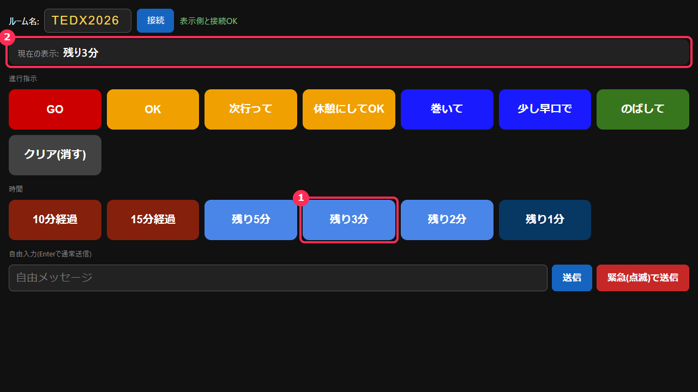
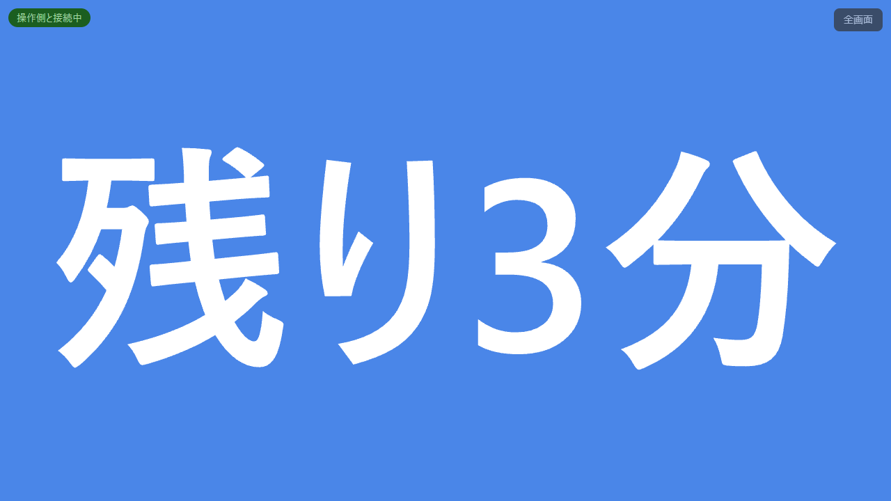

# 遠隔カンペ

登壇者の足元に置いた画面へ、離れた場所のタイムキーパーが「残り3分」「巻いて」などの合図を送るツールです。
インストールは不要で、ブラウザでURLを開くだけで使えます。

| タイムキーパーの画面（操作用） | 登壇者の足元の画面（表示用） |
|---|---|
|  |  |

## このツールのURL

**https://tmdmy.github.io/tedx_roder/kanpe.html**

> リポジトリを団体のGitHubへ移すとURLが変わります。移したらこの欄を書き換えてください（手順は[管理者向けガイド](docs/admin.md)）。

## 読むページを選ぶ

| あなたの状況 | 読むページ |
|---|---|
| 当日、カンペを出す・受ける係になった | **[当日の使い方](docs/usage.md)**（スクショ付き・5分） |
| 新しいイベントで使う準備をする | **[イベント前の準備](docs/setup.md)** |
| うまく動かない | **[困ったとき](docs/troubleshooting.md)** |
| Firebaseを作り直す／団体のGitHubへ移す／ボタンを変える | [管理者向けガイド](docs/admin.md) |

## 30秒でわかる仕組み

1. PCを2台用意し、両方で上のURLを開く
2. 足元のPCは「表示用」、タイムキーパーのPCは「操作用」を選ぶ
3. 両方に**同じルーム名**（例：`TEDX2026`）を入れる
4. 操作用でボタンを押すと、表示用に大きく出る

2台はインターネット経由でつながるので、同じWi-Fiである必要はありません。どちらもネットにつながっていれば動きます。

## 必要なもの

- ネットにつながるPCまたはタブレット 2台（ブラウザは Chrome か Edge を推奨）
- 2台で共通のルーム名（イベントごとに決める）

## ファイル構成

| ファイル | 中身 |
|---|---|
| `kanpe.html` | アプリ本体。これ1つで動く |
| `docs/` | 説明書とスクリーンショット |
