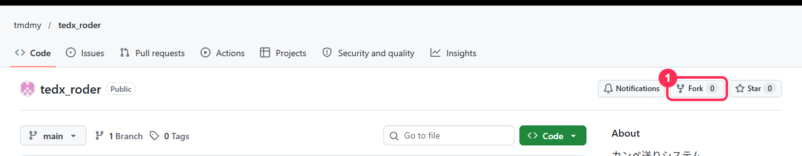
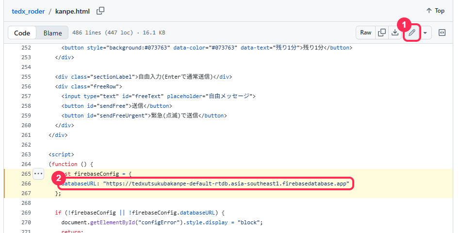

# 団体で使い始めるとき（最初の1回だけ）

[← 最初のページに戻る](../README.md)

このツールを**団体の持ち物として**使えるようにする手順です。最初に1回やれば、あとはイベントごとに[イベント前の準備](setup.md)をするだけになります。

プログラムの知識はいりません。書いてある順に、1つずつ進めてください。

## やることの全体

団体の持ち物にするものは2つあります。

| 持ち物 | 役目 | この手順でやること |
|---|---|---|
| **GitHubのリポジトリ** | ツール本体（`kanpe.html`）と説明書を置く場所。ここからツールのURLができる | 元のリポジトリを団体にコピーする |
| **Firebaseのプロジェクト** | 2台のPCの間でメッセージを受け渡す場所 | 団体用に新しく作る |

元のリポジトリは個人のもので、そこに書いてあるFirebaseも個人のものです。コピーしただけだと、**メッセージは個人のFirebaseを通ったまま**になり、止まったときに団体の人では直せません。だから、Firebaseも団体用に作って差し替えます。

| 手順 | 内容 | 目安 |
|---|---|---|
| [0](#手順0-用意するもの) | 用意するもの | — |
| [1](#手順1-団体のgithubにコピーを作るfork) | 団体のGitHubにコピーを作る | 3分 |
| [2](#手順2-団体用のfirebaseを作る) | 団体用のFirebaseを作る | 10分 |
| [3](#手順3-firebaseのルールを設定する) | Firebaseのルールを設定する | 3分 |
| [4](#手順4-ツールの接続先を団体のfirebaseに書き換える) | ツールの接続先を書き換える | 5分 |
| [5](#手順5-ツールのurlを作るgithub-pages) | ツールのURLを作る | 5分 |
| [6](#手順6-動くことを確かめる) | 動くことを確かめる | 5分 |
| [7](#手順7-説明書のurlを団体のものに直す) | 説明書のURLを直す | 3分 |
| [8](#手順8-ほかの人も管理できるようにする) | ほかの人も管理できるようにする | 5分 |

GitHubとFirebaseの画面は英語や日本語が混ざり、デザインもときどき変わります。ボタンの名前が少し違っていたら、近い名前のものを探してください。

---

## 手順0. 用意するもの

- **PC**（スマホでは作業しづらいです）
- **GitHubのアカウント**で、団体のOrganizationに**リポジトリを作れる権限**があるもの
  - わからなければ、団体のGitHubを管理している人に「リポジトリを作れる権限がほしい」と頼みます
- **Googleアカウント**。できれば団体で共有しているもの（例：団体の代表メールアドレス）
  - 個人のGoogleアカウントで作ってもかまいませんが、その場合は[手順8](#手順8-ほかの人も管理できるようにする)を必ずやってください
- **メモ帳**（PCのメモ帳アプリでよい）。途中でURLを2つ控えます

費用はかかりません。Firebaseは無料プラン（Spark）のまま使えます。クレジットカードの登録も不要です。

---

## 手順1. 団体のGitHubにコピーを作る（Fork）

「Fork（フォーク）」は、リポジトリを丸ごとコピーするGitHubの機能です。元のリポジトリは変わりません。

1. GitHubにログインする
2. [元のリポジトリ](https://github.com/tmdmy/tedx_roder)を開く
3. 右上の「Fork」を押す

   

4. 「Create a new fork」という画面になります。次のように入れます

   | 欄 | 入れるもの |
   |---|---|
   | **Owner** | **団体のOrganization名**を選ぶ。最初は自分の名前になっているので、必ず変える |
   | **Repository name** | そのままでもよい。変えるなら `kanpe` など半角英数字で。**ここの名前がツールのURLの一部になります** |
   | Description | そのままでよい |
   | Copy the `main` branch only | チェックが入ったままでよい |

5. 緑の「Create fork」を押す

**確認**：画面の左上が `団体のOrganization名 / リポジトリ名` になっていて、その下に小さく `forked from tmdmy/tedx_roder` と出ていれば成功です。

**メモ①**：このページのURL（`https://github.com/団体名/リポジトリ名`）をメモ帳に控えます。これ以降「団体のリポジトリ」と呼びます。

> Ownerの一覧に団体が出てこないときは、リポジトリを作る権限がありません。手順0に戻って権限を頼んでください。

---

## 手順2. 団体用のFirebaseを作る

### 2-1. プロジェクトを作る

1. [Firebaseコンソール](https://console.firebase.google.com/)を開く
2. 右上のアイコンを見て、**団体のGoogleアカウント**でログインしていることを確かめる。違っていたらアイコンを押して切り替える
3. 「プロジェクトを作成」（または「Firebaseプロジェクトを新規作成」）を押す
4. プロジェクト名を入れる。例：`kanpe-団体名`（半角英数字とハイフン）。「続行」を押す
5. AIアシスタント（Gemini）やGoogleアナリティクスを有効にするか聞かれたら、**どちらもオフ**にして進む。このツールでは使いません
6. 「プロジェクトを作成」を押し、1分ほど待つ。「新しいプロジェクトの準備ができました」と出たら「続行」を押す

### 2-2. Realtime Database を作る

1. 左のメニューから「**Realtime Database**」を開く
   - 「構築」という項目を開くと中にあります。見つからなければ、左メニューの「すべてのプロダクト」から探します
   - **「Firestore Database」ではありません。** 名前が似ていますが別物で、間違えると動きません
2. 「データベースを作成」を押す
3. ロケーションを聞かれたら「**シンガポール (asia-southeast1)**」を選んで「次へ」
   - 日本にいちばん近い選択肢です。あとから変えられません
4. セキュリティルールを聞かれたら「**ロックモードで開始**」を選んで「有効にする」
   - 「テストモード」は選びません。30日後に自動で使えなくなる設定だからです。ルールは次の手順で正しく入れます

**確認**：「データ」というタブが開き、上のほうにこういうURLが出ていれば成功です。

```
https://プロジェクト名-default-rtdb.asia-southeast1.firebasedatabase.app/
```

**メモ②**：このURLをメモ帳に控えます。URLの左にあるコピーのマークを押すと、打ち間違いなくコピーできます。これが「接続先」です。

---

## 手順3. Firebaseのルールを設定する

「誰が読み書きできるか」の設定です。これをやらないと、ツールに「Firebaseに拒否されました」と出て動きません。

1. 手順2の続きの画面で、上のタブの「**ルール**」を押す
2. 編集欄をクリックし、`Ctrl + A` で全部選んで `Delete` で消す
3. 下をそのままコピーして貼る

   ```json
   {
     "rules": {
       "rooms": {
         "$room": {
           ".read": true,
           ".write": true
         }
       }
     }
   }
   ```

4. 編集欄の上の「**公開**」を押す
   - 「セキュリティルールが公開として定義されています」のような警告が出ても、そのまま公開してかまいません（理由は下）

**確認**：「公開」ボタンが押せない状態（灰色）に戻り、警告以外の赤いエラーが出ていなければ成功です。

### このルールの意味

- ルーム名を知っている人だけが、そのルームにメッセージを送ったり見たりできます。ルーム名が合言葉の役目をします
- ルームの一覧は誰にも見えません
- このルールには期限がありません。来年もそのまま使えます
- 流れるのは「残り3分」のような合図だけです。**個人情報や秘密は送らないでください**

---

## 手順4. ツールの接続先を団体のFirebaseに書き換える

ツール本体（`kanpe.html`）の中に、接続先が1行だけ書いてあります。いまは元の持ち主のFirebaseになっているので、手順2で作ったものに書き換えます。

1. **メモ①**の団体のリポジトリを開く
   - 左上が団体名になっていることを確かめます。元のリポジトリ（`tmdmy/...`）ではありません
2. ファイルの一覧から `kanpe.html` を押す
3. 右上の**鉛筆マーク**（①）を押す

   

4. `databaseURL` と書いてある行（②）を探す。`Ctrl + F` で `databaseURL` と検索すると早いです。266行目あたりにあります
5. `"` と `"` の間のURLを消して、**メモ②**のURLを貼る

   書き換える前：
   ```javascript
       databaseURL: "https://tedxutsukubakanpe-default-rtdb.asia-southeast1.firebasedatabase.app"
   ```
   書き換えた後（例）：
   ```javascript
       databaseURL: "https://kanpe-dantai-default-rtdb.asia-southeast1.firebasedatabase.app/"
   ```

   **気をつけること**
   - 前後の `"`（ダブルクォーテーション）は消さない。全角の `”` にしない
   - `databaseURL:` の部分や、行の前の空白は変えない
   - URLの最後の `/` は、あってもなくても動きます
   - **ほかの行は一切さわらない**

6. 右上の緑の「**Commit changes...**」を押す
7. 小さな画面が出ます。「Commit directly to the `main` branch」が選ばれていることを確かめて、緑の「**Commit changes**」を押す

**確認**：`kanpe.html` の表示に戻り、266行目あたりが団体のURLになっていれば成功です。

> 間違えたかもしれないときは、もう一度鉛筆マークを押して直せます。大きく壊してしまったときは、`kanpe.html` の画面の右上にある「History」から前の状態を見られます。

---

## 手順5. ツールのURLを作る（GitHub Pages）

コピーしただけでは、ツールを開くURLがまだありません。GitHub Pages という機能をオンにします。

1. 団体のリポジトリで、上のメニューの「**Settings**」を押す
   - 「Settings」が見えないときは、そのリポジトリの管理権限がありません。Forkした本人か、団体の管理者が行います
2. 左のメニューの「**Pages**」を押す
3. 「Build and deployment」の「Source」が「**Deploy from a branch**」になっていることを確かめる
4. 「Branch」で、`None` を **`main`** に変える。右のフォルダは `/ (root)` のままにする
5. 「**Save**」を押す
6. 2〜3分待ってから、ページを再読み込み（`F5`）する

**確認**：ページの上のほうに「Your site is live at `https://団体名.github.io/リポジトリ名/`」と出れば成功です。出ないときは、もう少し待って再読み込みします。

ツールのURLは、そこに `kanpe.html` を足したものです。

```
https://団体名.github.io/リポジトリ名/kanpe.html
```

**メモ③**：このURLをメモ帳に控えます。これが団体の「ツールのURL」です。開いて、「表示用」「操作用」の2つのボタンが出ることを確かめます。

> 団体のリポジトリを非公開（Private）にすると、GitHubが無料プランの場合はこのURLが使えなくなります。公開（Public）のままにしてください。

---

## 手順6. 動くことを確かめる

**ここがいちばん大事です。** ツールが開くだけでなく、団体のFirebaseを通ってメッセージが届くことを確かめます。

### 6-1. つながるか

1. ブラウザのタブを2つ開き、両方で**メモ③**のURLを開く
2. 1つ目で「表示用」を押し、ルーム名に `TEST1` と入れて「OK」
3. 2つ目で「操作用」を押し、ルーム名に `TEST1` と入れて「接続」
4. 操作用の上の文字が、緑の「**表示側と接続OK**」になるのを待つ（数秒）
5. 「残り3分」を押し、1つ目のタブに大きく「残り3分」と出ることを見る

画面の見え方は[当日の使い方](usage.md)のスクリーンショットと同じです。

### 6-2. 団体のFirebaseを通っているか

1. タブをもう1つ開き、Firebaseコンソールの「Realtime Database」→「データ」タブを開く
2. `rooms` → `TEST1` という項目ができていれば、団体のFirebaseを通っています
3. 操作用でボタンを押すたびに、`current` の中の `text` が変わることを見る

`rooms` ができていないのにメッセージが届く場合は、まだ元のFirebaseを通っています。手順4の書き換えが保存されていないか、反映待ちです。2〜3分待って、ツールのタブを再読み込みしてからやり直します。

### うまくいかないとき

| 操作用の上に出る文字 | 原因と直し方 |
|---|---|
| 赤の「Firebaseに拒否されました(ルールを確認)」 | ルールが入っていません。[手順3](#手順3-firebaseのルールを設定する)をやり直し、「公開」を押したか確かめる |
| 赤の「表示側が見つかりません」のまま | 2つのタブのルーム名が違う。または、手順4で貼ったURLが間違っている（メモ②と1文字ずつ見比べる） |
| 「表示用」「操作用」のボタンを押しても何も起きない | 手順4で `"` を消したなど、`kanpe.html` を壊しています。手順4の「書き換えた後」の例と見比べて直す |
| 赤い文字だけの画面「Firebaseの設定がまだ入っていません」 | `"` と `"` の間が空です。メモ②のURLを貼り直す |
| ページが「404」になる | [手順5](#手順5-ツールのurlを作るgithub-pages)がまだ反映されていないか、URLの打ち間違い |

確かめ終わったら、Firebaseコンソールの「データ」タブで `rooms` にマウスを乗せ、右に出る「×」で削除しておきます（残っていても害はありません）。

---

## 手順7. 説明書のURLを団体のものに直す

コピーした説明書には、元のURLが書かれたままです。係の人が間違って元のURLを開かないように、団体のURLに直します。

1. 団体のリポジトリを開き、ファイルの一覧から `README.md` を押す
2. 右上の鉛筆マークを押す
3. 「このツールのURL」のすぐ下にあるURLを、**メモ③**のURLに書き換える。前後の `**` は残す

   ```
   **https://団体名.github.io/リポジトリ名/kanpe.html**
   ```

4. そのすぐ下の、`>` で始まる注意書きの1行（「元のリポジトリは個人のアカウントにあります…」）を消す
5. 案内表の中の「団体で初めて使う」の行も消してよい（もう済んだため）
6. 「Commit changes...」→「Commit changes」を押す

**確認**：団体のリポジトリの最初のページに、団体のURLが出ていれば成功です。

---

## 手順8. ほかの人も管理できるようにする

作った本人しか入れないと、その人が卒業したり連絡がつかなくなったりしたときに、誰も直せなくなります。**どちらも2人以上**が入れるようにします。

### Firebase

1. Firebaseコンソールで、左上の歯車マーク →「**ユーザーと権限**」を押す
2. 「**メンバーを追加**」を押す
3. 追加する人のGoogleアカウントのメールアドレスを入れ、役割で「**オーナー**」を選んで追加する
4. 追加された人にメールが届くので、その人が承認する

### GitHub

団体のOrganizationに入っている人のうち、リポジトリを編集できる人が2人以上いることを確かめます。足りなければ、団体のリポジトリの「Settings」→「Collaborators and teams」から追加します。

### 引き継ぎメモを残す

次の3つを、団体の引き継ぎ資料（共有ドライブなど）に書いておきます。

- 団体のリポジトリのURL（メモ①）
- ツールのURL（メモ③）
- FirebaseをどのGoogleアカウントで作ったか、誰がオーナーか

---

## 終わったかどうかのチェック

- [ ] 団体のGitHubにリポジトリがある
- [ ] 団体のGoogleアカウントにFirebaseのプロジェクトがある
- [ ] ルールを貼って「公開」した
- [ ] `kanpe.html` の接続先が団体のFirebaseになっている
- [ ] 団体のツールのURLが開ける
- [ ] 2つのタブでつないで、メッセージが届いた
- [ ] そのとき、団体のFirebaseの「データ」に `rooms` ができた
- [ ] `README.md` のURLを団体のものに直した
- [ ] FirebaseとGitHubに、管理できる人が2人以上いる
- [ ] 引き継ぎメモを残した

全部チェックできたら完了です。これ以降は、**団体のリポジトリと団体のURLだけ**を使ってください。

## このあと

- イベントで使うとき → [イベント前の準備](setup.md)
- 係の人に渡す説明 → [当日の使い方](usage.md)
- ボタンの文言を変えたい → [管理者向けガイドの「ボタンを変える」](admin.md#4-ボタンを変える)

### 元のリポジトリの更新を取り込むとき

元のリポジトリが更新されると、団体のリポジトリの上のほうに「This branch is 1 commit behind」のような表示と「**Sync fork**」ボタンが出ます。

- 「Sync fork」→「**Update branch**」を押すと、更新を取り込めます。団体で書き換えた接続先やURLはそのまま残ります
- **「Discard commits」は絶対に押さないでください。** 団体で書き換えた内容（接続先、URL）が全部消えて、元の状態に戻ってしまいます
- 「conflicts（競合）」と出て取り込めないときは、取り込まなくてかまいません。今のままで動き続けます
- 取り込んだあとは、[手順6](#手順6-動くことを確かめる)をもう一度やって確かめます
