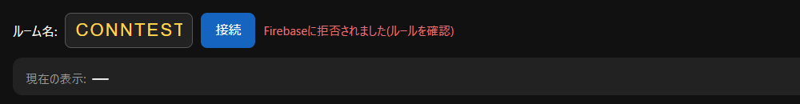

# イベント前の準備

[← 最初のページに戻る](../README.md)

新しいイベントでこのツールを使うときに、担当者がやることです。プログラムの知識はいりません。
**イベントの1週間前まで**に済ませておくと、問題があっても直す時間がとれます。

## 1. 動くかどうか確かめる（一番大事）

このツールは Firebase というGoogleのサービスを通して2台をつないでいます。Firebase側の設定が閉じていると、URLは開けてもメッセージが届きません。必ず最初に確かめます。

1. PC（1台でもよい）でブラウザのタブを2つ開き、両方で[ツールのURL](../README.md#このツールのurl)を開く
2. 片方を「表示用」、もう片方を「操作用」にして、同じルーム名（`TEST1` など）でつなぐ
3. 操作用の上の表示を見る

| 表示 | 意味 |
|---|---|
| 緑の「表示側と接続OK」 | 使えます。次へ進む |
| 赤の「Firebaseに拒否されました(ルールを確認)」 | Firebaseの設定が閉じています。[管理者向けガイドの「ルールを開ける」](admin.md#1-firebaseのルールを開ける)を管理者に頼む |



## 2. ルーム名を決める

ルーム名は「合言葉」です。同じルーム名を入れた画面どうしがつながります。

- 半角の英数字だけ、2〜24文字
- **ほかのイベントと違う名前にする**（同じ名前だと、相手の画面にもメッセージが出てしまいます）
- 知っていれば誰でもメッセージを送れるので、当てにくい名前にする
  - 良い例：`TEDX2026K7Q`、`SPRING26MX4`（イベント名＋適当な文字）
  - 悪い例：`TEST`、`1234`、`TEDX2026`（説明書の例のまま）
- 会場が複数あるなら、会場ごとに別の名前にする（`...A`、`...B`）

## 3. 係の人にURLを配る

2通りあります。

**かんたんな方法**：[ツールのURL](../README.md#このツールのurl)とルーム名をそのまま伝える。係の人は[当日の使い方](usage.md)の通りに操作します。

**楽な方法**：ルーム名入りのURLを作って配る。開くだけでつながるので、当日の入力ミスがなくなります。ツールのURLの後ろに次を足します（`TEDX2026K7Q` の部分を決めたルーム名に変える）。

```
表示用（足元のPC）　　　…/kanpe.html?mode=display&room=TEDX2026K7Q
操作用（タイムキーパー）…/kanpe.html?mode=ctrl&room=TEDX2026K7Q
```

作ったURLは自分で一度開いて、つながることを確かめてから配ります。足元のPCではブックマークしておくと便利です。

## 4. 会場でリハーサルする

会場のネット回線で試します。[当日の使い方の「本番前チェックリスト」](usage.md#本番前チェックリスト)をそのまま使ってください。

会場のWi-Fiが不安定なときは、スマホのテザリングでも動きます。通信量はごくわずかです。

## 5. ボタンの文言を変えたいとき

「残り5分」を「残り7分」にしたい、ボタンを足したい、という場合は[管理者向けガイドの「ボタンを変える」](admin.md#4-ボタンを変える)を見てください。
その場かぎりの合図なら、自由入力で送るほうが早いです。
