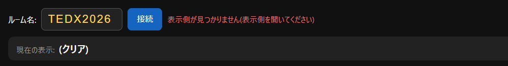
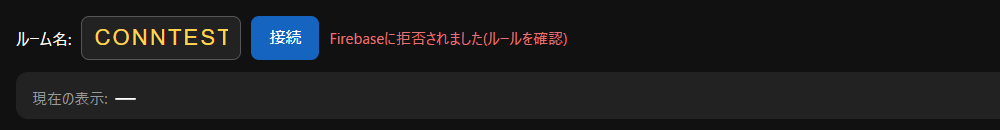

# 困ったとき

[← 最初のページに戻る](../README.md)

まず、**操作用の上の文字**と**表示用の左上の文字**を見てください。その文字で原因がわかります。

## 表示されている文字から探す

### 「表示側が見つかりません(表示側を開いてください)」（操作用）／「操作側の応答なし」（表示用）

相手の画面が見つかっていません。上から順に確かめます。

1. **相手のPCでツールが開いているか。** タブを閉じていないか、別のタブを見ていないか
2. **ルーム名が同じか。** 表示用は画面中央（待機中）に、操作用は左上に出ています。`0`（ゼロ）と `O`（オー）、`1` と `I` の間違いが多いです
3. **相手のPCがスリープしていないか。** 画面が消えていたらキーを押して起こす
4. 10秒待っても変わらなければ、両方のPCでページを再読み込み（`F5` キー）する

### 「Firebaseに拒否されました(ルールを確認)」

係の人の操作ミスではありません。Firebase側の設定が閉じています。当日その場では直せないことが多いので、**管理者に連絡**してください。管理者は[管理者向けガイドの「ルールを開ける」](admin.md#1-firebaseのルールを開ける)で直せます（5分ほど）。

### 「ネット接続なし」

そのPCがインターネットにつながっていません。Wi-Fiを確認します。会場のWi-Fiがだめなら、スマホのテザリングに切り替えます。つながれば自動で元に戻ります。

### 「ルーム名は英数字2文字以上」

ルーム名が空か1文字です。半角の英数字で2文字以上入れてください。

### 「先にルームへ接続してください」

ルーム名を入れて「接続」を押す前に、ボタンを押しています。

### 「送信失敗 — ネットとFirebaseルールを確認」

そのメッセージは届いていません。ネットを確認してもう一度押します。何度やっても同じなら、上の「Firebaseに拒否されました」と同じ対応をします。

## 症状から探す

| 症状 | 対処 |
|---|---|
| 赤い文字だけの画面「Firebaseの設定がまだ入っていません」が出る | `kanpe.html` の中の接続先が空です。管理者に連絡（[管理者向けガイド](admin.md#2-firebaseを新しく作る)） |
| ページが真っ白、または開けない | URLの打ち間違い、またはネットにつながっていない。[最初のページ](../README.md#このツールのurl)からURLをコピーし直す |
| 途中から急につながらなくなった | どちらかのPCがスリープしたか、ブラウザが裏に回っています。起こして、ツールのタブを一番手前に出す |
| 前のメッセージが出たままになる | 自動では消えません。操作用で「クリア(消す)」を押す |
| 開いた直後に、前回のメッセージが出る | そのルームで最後に送った内容が残っています。「クリア(消す)」を押す |
| 知らないメッセージが出た | 同じルーム名を使っている人がほかにいます。ルーム名を変えて、両方つなぎ直す |
| 文字が小さい | 文章が長いと小さくなります。短く言い換える。定型ボタンは常に最大サイズで出ます |
| 「全画面」を押しても全画面にならない | iPhoneでは使えません。PCかタブレットを使う |
| 点滅が止まらない | 「クリア(消す)」か、別のメッセージを送ると止まります |

## それでもだめなとき

1. 両方のPCでページを再読み込み（`F5`）
2. ブラウザを Chrome か Edge に変える
3. 別のルーム名でつなぎ直す
4. 管理者に、**画面に出ている赤い文字をそのまま**伝える
