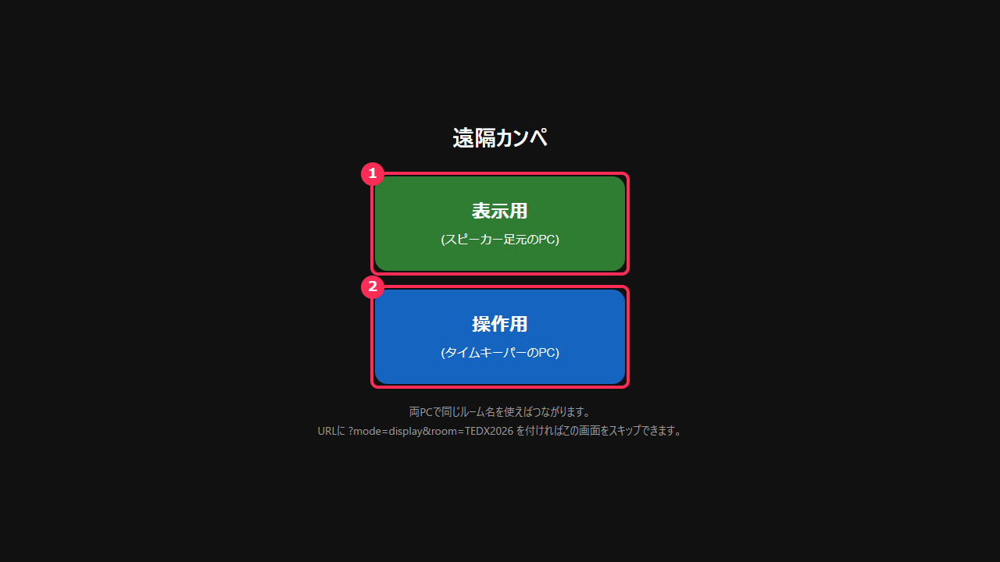
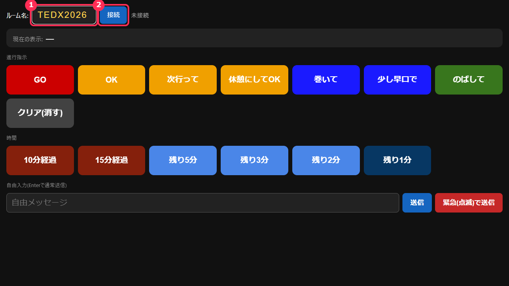
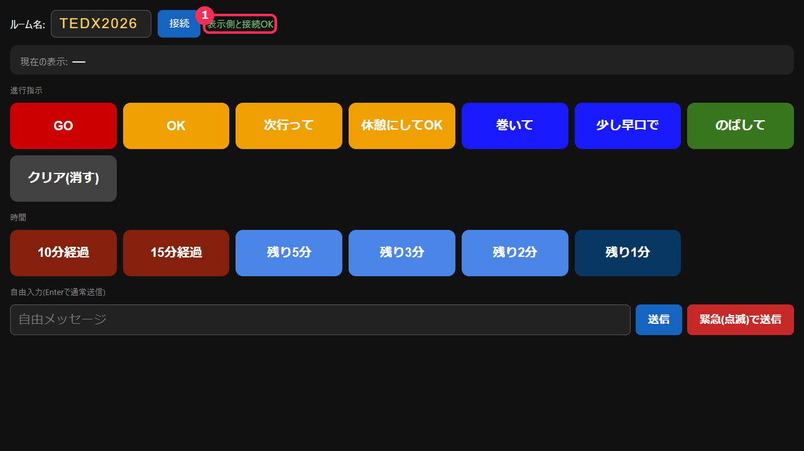
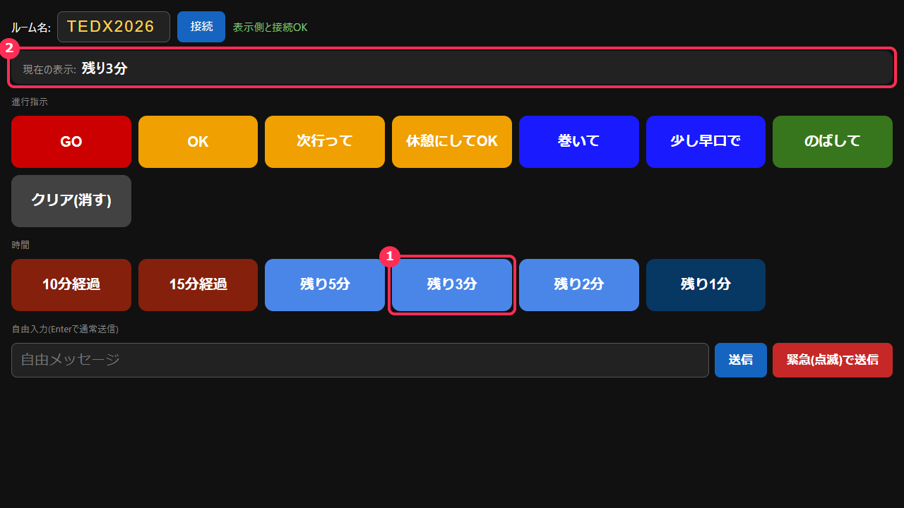
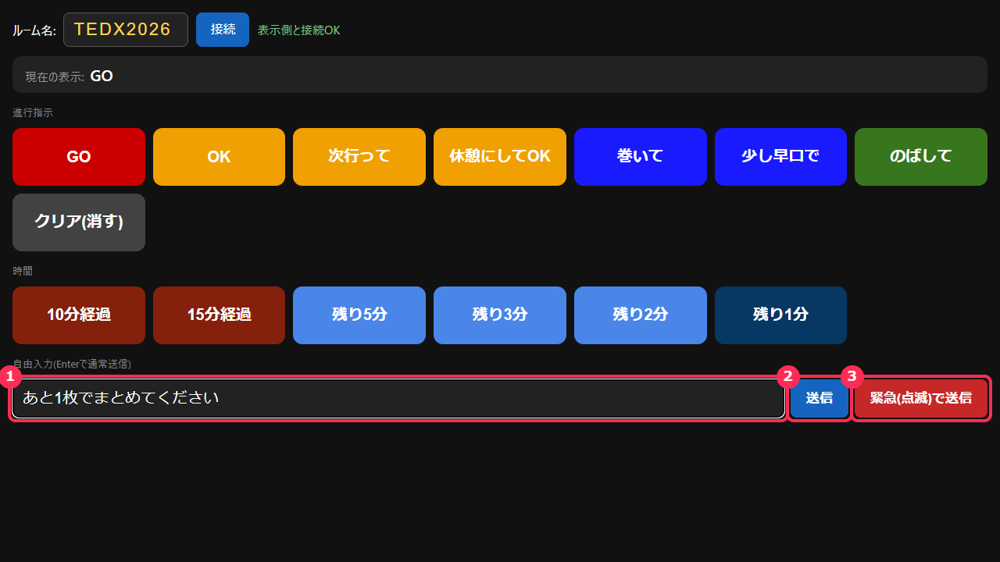
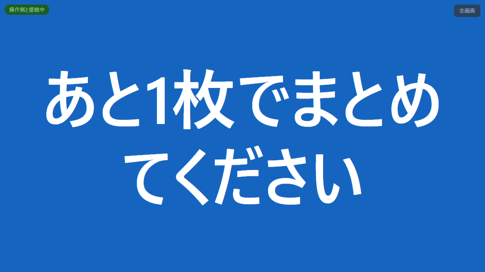
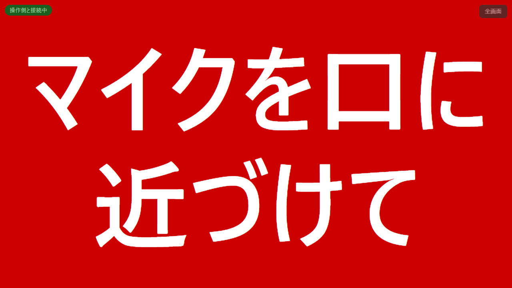

# 当日の使い方

[← 最初のページに戻る](../README.md)

PCを2台使います。先に**表示用**（足元のPC）を開き、次に**操作用**（タイムキーパーのPC）を開くと迷いません。

- ツールのURLは[最初のページ](../README.md#このツールのurl)にあります
- ルーム名はイベントの担当者に確認してください（この説明では `TEDX2026` を例にします）

---

## A. 表示用（登壇者の足元のPC）

### 1. URLを開いて「表示用」を押す

① の緑のボタンを押します。

### 2. ルーム名を入れる

画面の上に小さな入力欄が出ます。ルーム名を入力して「OK」を押します。

- 半角の英数字で入れます。小文字で入れても自動で大文字になります
- 記号や日本語は自動で消えます

### 3. 待機画面になったことを確認する

- ① ルーム名が合っているか確認します
- ② 左上は、操作用がまだつながっていないので赤い「操作側の応答なし」になります。この時点では正常です

### 4. 操作用がつながったら全画面にする

- ① 左上が緑の「操作側と接続中」になれば準備完了です
- ② 右上の「全画面」を押すと、ブラウザの枠が消えて画面いっぱいになります（戻すときは `Esc` キー）

### 5. PCがスリープしないようにする

**ここが一番大事です。** 画面が消えるとカンペも消えます。

- 電源アダプタをつなぐ
- スリープと画面オフを「なし」にする（Windows：設定 → システム → 電源とバッテリー → 画面とスリープ／Mac：システム設定 → ロック画面）
- 通知が出ないよう、ほかのアプリは閉じておく

---

## B. 操作用（タイムキーパーのPC）

### 1. URLを開いて「操作用」を押す

[モード選択画面](images/01-mode-select.png)で ② の青いボタンを押します。

### 2. ルーム名を入れて「接続」を押す

① に表示用と**同じ**ルーム名を入れ、② の「接続」を押します。

### 3. 「表示側と接続OK」を確認する

① が緑の「表示側と接続OK」になれば準備完了です。数秒かかることがあります。
赤い文字のままなら[困ったとき](troubleshooting.md)を見てください。

### 4. ボタンを押して送る

- ① ボタンを押すと、その瞬間に表示用へ出ます
- ② 「現在の表示」に、いま足元に出ている内容が出ます。送れたかどうかはここで確認できます

表示用にはこう出ます。

| 「残り3分」を押したとき | 「GO」を押したとき |
|---|---|
|  |  |

**出したメッセージは自動では消えません。** 読んでもらえたら「クリア(消す)」を押して消します。

### 5. 好きな文章を送る

- ① に文章を打つ
- ② 「送信」または `Enter` キーで、青い背景で出ます
- ③ 「緊急(点滅)で送信」は、赤い背景が点滅します。本当に急ぐときだけ使います

| 通常の送信 | 緊急(点滅)で送信 |
|---|---|
|  |  |

文章は短いほど大きく出ます。15文字くらいまでが読みやすいです。

---

## 本番前チェックリスト

リハーサルのときに、2人で声を掛け合って確認します。

- [ ] 表示用の左上が緑「操作側と接続中」
- [ ] 操作用の上が緑「表示側と接続OK」
- [ ] 「残り3分」を押して、足元に出た
- [ ] 登壇位置から文字が読める（読めなければ画面の角度や明るさを調整）
- [ ] 「クリア(消す)」で消えた
- [ ] 表示用は全画面になっている
- [ ] 2台とも電源につないであり、スリープしない設定になっている
- [ ] 5分放置しても、緑の表示のまま

## 終わったら

2台ともブラウザのタブを閉じるだけです。
